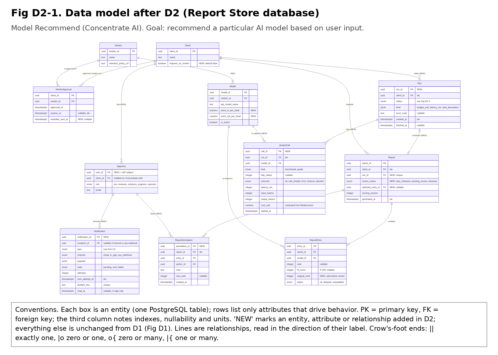
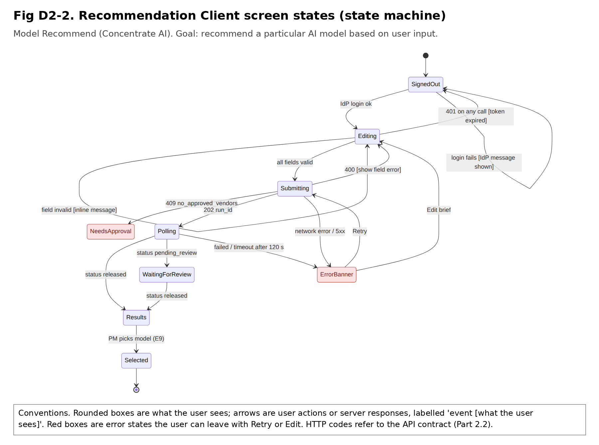
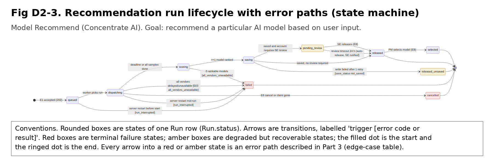
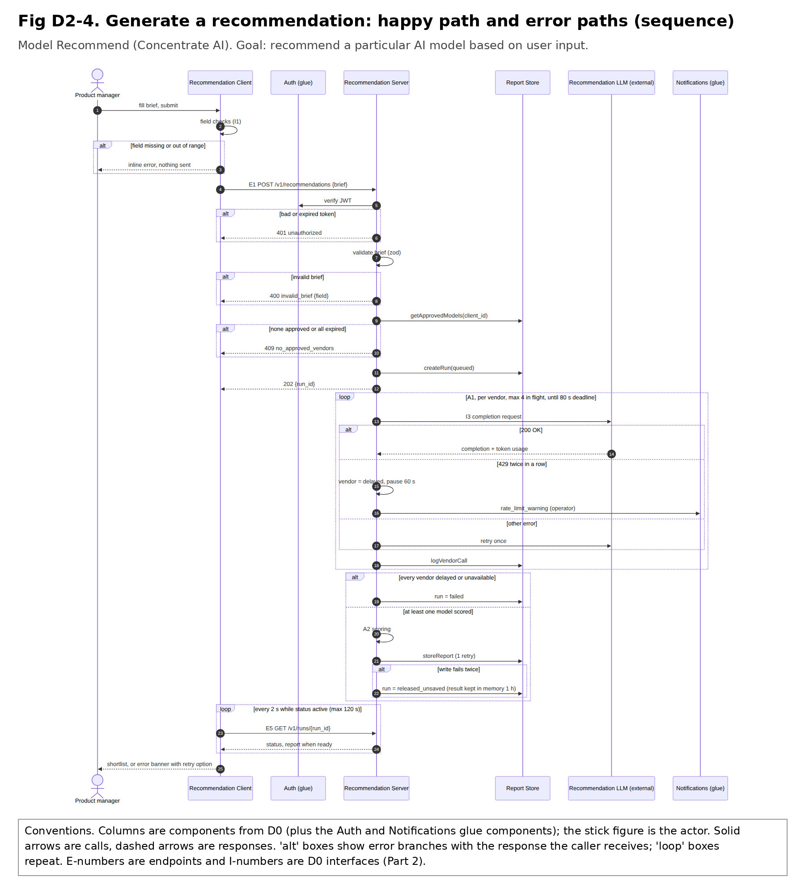
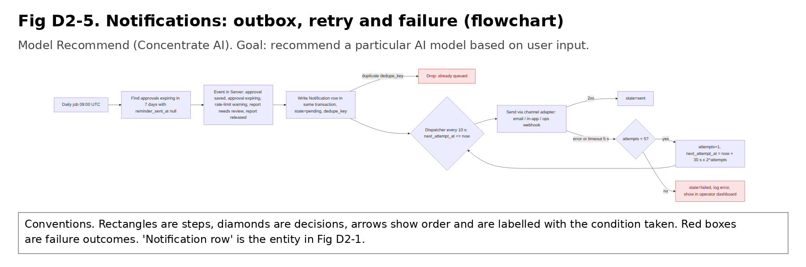

# D2 — Detailed Design

**Project:** Model Recommend (Concentrate AI)
**Team:** Allison Oh, Aditya Pawar

## 1. Header, Conventions, and D2 Overview

**Title:** Model Recommend — D2 Detailed Design

**Goal statement:** The goal of the project is to recommend a particular AI model based on user input.

**Conventions.** Every figure carries the title, the goal statement and its own conventions box. Shared rules across figures:

- Requirement IDs (US-nn, UC-nn, AC-nn.n) refer to *User_Stories.md*. Interface IDs (I1–I4) and decision IDs (D-nn) refer to *D0_High_Level_Design*. Algorithm IDs (A1, A2) and endpoint IDs E1–E4 come from *D1_Detailed_Design*; E5–E12 are new in D2.
- In data-model figures a box is a PostgreSQL table. In state machines a rounded box is a state and an arrow is a transition labelled `trigger [result]`. In sequence diagrams a column is a component, a solid arrow is a call and a dashed arrow is a response.
- **Red** boxes are failure states or outcomes and **amber** boxes are degraded-but-recoverable ones. Fig D2-3, D2-4, D2-2 and D2-5 all show error paths.
- Units: money in USD, latency in milliseconds, timestamps ISO-8601 UTC.

### Two-minute overview

**What the system is.** A product manager at a client company submits a brief: a budget ceiling, a latency ceiling and a task description. Model Recommend sends sanitized sample prompts from that task to the AI models of every vendor the client's IT security reviewer has approved. It grades and times the answers, prices them, and returns a ranked shortlist with a 0–100 fit score and a plain-language reason for each model. The system has a React client, one TypeScript server, a PostgreSQL store, and the vendors' APIs as the external dependency (D0).

**What D1 covered.** The Recommendation Server's two core algorithms (A1 parallel dispatch with per-vendor rate-limit handling; A2 weighted scoring), the Report Store's data model, and the public API (E1–E4).

**What D2 adds.**

1. **The components D1 deferred:** the Recommendation Client (screens, state machine, calls) and the Recommendation LLM adapter (the I3 contract, with cost computed from token counts).
2. **The two user stories D1 left without a design:** US-03 (solutions engineer review before the client sees a report) and US-05 (operator alert before a vendor's rate limit is exceeded). Also UC-01 steps 8–9, where the product manager selects a model.
3. **The glue components:** authentication, notifications, configuration, and logging plus the vendor usage log.
4. **A run lifecycle.** E1 now starts a run and returns `202` instead of holding the HTTP request open for up to 90 s. That gives the review step and cancellation a place to live (Fig D2-3).
5. **New data:** Run, VendorCall, ReportAnnotation, Notification and AppUser entities, plus new columns on existing ones (Fig D2-1).
6. **Edge cases, traceability, rationale and peer review** (Parts 3–6).

### Known gaps and open questions

| # | Gap or question | Where it shows | Owner | Plan |
|---|---|---|---|---|
| G1 | D0 lists I4 as "Internal RPC (HTTPS)" while D1 uses the PostgreSQL wire protocol. | D0 Part 4, D1 Part 5 | Allison Oh | Fix D0's I4 row and note the change in the rationale (Part 5). |
| G2 | D0's I3 says the vendor returns `cost_usd`. Vendors return token counts, not cost, so the Server computes cost from Model prices (Part 2.4). | D0 Part 4 | Aditya Pawar | Fix D0's I3 row and note it in the rationale. |
| G3 | AC-01.1 requires at least 3 models, but A2 returns fewer with a `fewer_than_3_models` warning when vendors fail. | D1 A2, AC-01.1 | Allison Oh | Decide: amend the AC with the client, or treat it as a documented gap in Part 4. |
| G4 | UC-01's exception flow says "more than 2 consecutive" 429s; AC-01.3 and A1 say 2. | User_Stories | Allison Oh | Confirm 2 with the advisor and fix the UC text. |
| G5 | D0's I1 says `budget (USD)`; D1 defines it as USD per 1,000 requests. | D0 Part 4 | Allison Oh | Use "USD per 1,000 requests" everywhere. |
| G6 | Changing E1 to return `202` is a breaking change under D1's versioning rule. No client exists yet, so we keep `/v1`. | Part 2.2 | Aditya Pawar | Confirm with the team; otherwise ship as `/v2`. |
| G7 | "Close to being exceeded" (US-05) has no number in the user stories. D2 proposes 10% of the vendor's remaining-requests header, or the first 429. | Part 2.6 | Aditya Pawar | Confirm the threshold with the Concentrate AI platform operator. |
| G8 | Who the identity provider is and how users get roles is not decided. | Part 2.5 | Aditya Pawar | Confirm with Concentrate AI. |
| G9 | Prompt sanitization is a small rule set (emails, phone numbers). | D1 Part 4 | Aditya Pawar | Decide whether D2 adopts a PII-detection library. |

## 2. Finished Components (D2 Diagrams)

### 2.0 Component audit (D0 box by box)

| D0 component | Data model | Behavior | Interface | Where |
|---|---|---|---|---|
| Recommendation Client | No persistent data (in-memory state only) | State machine, Fig D2-2 | Screens S1–S6 and calls to E1–E12 | 2.1 |
| Recommendation Server | Run, VendorCall, ReportAnnotation (stored in Report Store) | A1, A2 (D1); run lifecycle Fig D2-3; review and selection steps | E1–E12 | 2.2 |
| Report Store | Fig D2-1 | Transactions and constraints | Repository methods (I4) | 2.3 |
| Recommendation LLM *(external)* | No persistent data on our side; prices live on Model | Adapter step list | `callVendor` signature (I3, revised) | 2.4 |
| Authentication *(glue)* | AppUser | Token check step list | `authenticate`, `requireRole` | 2.5 |
| Notifications *(glue)* | Notification | Outbox and retry, Fig D2-5 | `notify`, dispatcher, channel adapters | 2.6 |
| Configuration *(glue)* | No persistent data (environment and versioned config file) | Load and validate at startup | `getConfig()` | 2.7 |
| Logging *(glue)* | VendorCall (usage log); application logs go to the platform, not our database | Structured log per request | `logger.child`, `logVendorCall` | 2.8 |

### 2.1 Recommendation Client

**Data model.** No persistent data. The client holds the access token in memory (never in local storage) and the brief being edited in component state. Everything durable lives in the Report Store and is read through the API.

**Behavior.** Fig D2-2 is the state machine for the main screen. Polling: after `202`, the client calls E5 every 2 s, stopping after 120 s or at a terminal status. Each request carries a client-generated `Idempotency-Key` so a double-click cannot start two paid runs.

**Interface.**

| Screen | Who | Calls | Shows on error |
|---|---|---|---|
| S1 Brief form | product manager | E1 | Inline field message (400); "Ask your IT reviewer to approve vendors" (409); banner with Retry (5xx or network) |
| S2 Run progress and shortlist | product manager | E5 (polling), E6 cancel, E9 select | Per-model status chips (`delayed`, `unavailable`); warnings list; "not saved" badge when `save_status = not_saved` |
| S3 Report history | product manager | E3, E2 | Empty state; 404 shows "report not found" |
| S4 Vendor approval | IT security reviewer | E7, E11, E4 | "at least 1 vendor required" (AC-02.2); 403 shows "reviewer access required" |
| S5 Review queue and review | solutions engineer | E10, E2, E8 | 409 when someone else already released the report |
| S6 Notifications | all roles | E12 | Silent retry on the next page load |

### 2.2 Recommendation Server (D2 additions)

**Data model.** Run, VendorCall and ReportAnnotation (Fig D2-1), stored through the Report Store.

**Behavior.**

- **Run lifecycle** (Fig D2-3). E1 validates synchronously (auth, brief, approved vendors), creates a Run in `queued`, returns `202 {run_id}`, and runs A1 → A2 → `storeReport` in-process. A run in `queued` or `dispatching` when the Server restarts is marked `failed` with `run_interrupted` at startup; the client shows Retry.
- **Review (US-03).** If `Client.requires_se_review` is true, a saved report goes to `pending_review`, and a `report_needs_review` notification goes to solutions engineers. E8 adds notes and may move at most two entries (UC-01 alternate flow); `original_rank` keeps the automated order. Releasing notifies the product manager. With no review within 24 h the report is released automatically and the engineer is told.
- **Selection (UC-01 steps 8–9).** E9 records `Report.selected_entry_id`. The entry must belong to the report and have status `ok`.
- **Rate-limit warning (US-05).** A1 reads each vendor's remaining-requests header. When it falls below 10% of the limit, or on the first 429, A1 emits one `rate_limit_warning` per vendor per 10 minutes (Part 2.6).

**Interface (I2).** E1–E4 are as in D1 except where noted. All endpoints need `Authorization: Bearer <JWT>`. Errors use `{error: code, message, field?}`.

| Endpoint | Role | Inputs | Outputs | Errors |
|---|---|---|---|---|
| **E1** `POST /v1/recommendations` *(revised)* | pm | D1 brief + header `Idempotency-Key` (uuid) | `202 {run_id, status: "queued"}`; the same key within 24 h returns the same run | D1 errors (`400 invalid_brief`, `401`, `409 no_approved_vendors`, `429 rate_limited`) plus `409 run_in_progress` (more than 3 active runs for the client) |
| **E5** `GET /v1/runs/{run_id}` *(new)* | pm, solutions_engineer | path `run_id` | `200 {run_id, status, warnings[], error_code?, report?}`; `report` is the D1 E1 shape, present once released | `400 invalid_id`, `401`, `404 run_not_found` |
| **E6** `POST /v1/runs/{run_id}/cancel` *(new)* | pm | path | `200 {status: "cancelled"}` | `404`, `409 run_not_active` |
| **E7** `GET /v1/vendors` *(new)* | reviewer | none | `200 [{vendor_id, name, retention_policy_url, models: [name]}]` | `401`, `403 reviewer_access_required` |
| **E8** `POST /v1/reports/{report_id}/review` *(new)* | solutions_engineer | `{annotations: [{entry_id, note (≤ 500 chars), new_rank?}], release: boolean}` | `200 {review_status, entries}` | `400 too_many_reorders` (more than 2), `400 invalid_rank`, `403`, `404`, `409 already_released` |
| **E9** `POST /v1/reports/{report_id}/selection` *(new)* | pm | `{entry_id}` | `200 {selected_entry_id, selected_at}` | `400 entry_not_selectable`, `404`, `409 report_not_released` |
| **E10** `GET /v1/review-queue` *(new)* | solutions_engineer | `limit`, `cursor` | `200 {reports: [...], next_cursor}` | `401`, `403` |
| **E11** `GET /v1/approved-vendors` *(new)* | reviewer, pm | none | `200 {vendor_ids, approved_at, expires_at}` | `401`, `404 no_approved_vendors` |
| **E12** `GET /v1/notifications` *(new)* | all | `limit`, `cursor`, `unread_only` | `200 {notifications: [{notification_id, type, payload, created_at, read}], next_cursor}` | `401` |

**D0 interface revisions.** I2's single synchronous call is now E1 plus E5 (start, then poll), so no request is held open past platform timeouts. I3 is revised in 2.4. I4's protocol is corrected (G1). The internals that had leaked into requests are removed: `client_id` never travels in a body, and vendor API names stay inside the Server.

### 2.3 Report Store (D2 additions)

**Data model.** Fig D2-1. New indexes: `runs (client_id, created_at DESC)`; `vendor_calls (run_id)`; `notifications (state, next_attempt_at)` partial `WHERE state = 'pending'`; `notifications (dedupe_key)` unique; `reports (review_status)` partial `WHERE review_status = 'pending_review'`.

**Behavior.** `storeReport` writes Report, its entries and any notification rows in one transaction, so a released report and its notification are never out of step. Run status changes are a single `UPDATE ... WHERE status = <expected>`; zero rows updated means another actor got there first and the call returns `Conflict`.

**Interface (I4, new repository methods).**

| Method | Inputs | Outputs | Errors |
|---|---|---|---|
| `createRun(client_id, brief, idempotency_key)` | uuid, brief, uuid | `{run_id}`; an existing run if the key was used | `WriteFailed` |
| `transitionRun(run_id, from, to, error_code?)` | uuid, status, status, string | `{status}` | `Conflict` (status changed underneath) |
| `logVendorCall(call)` | VendorCall without id | none (batched every 1 s) | `WriteFailed` logged; never fails the run |
| `saveReview(report_id, author_id, annotations, release)` | uuid, uuid, list, bool | updated report | `Conflict`, `NotFound` |
| `selectEntry(client_id, report_id, entry_id)` | uuids | `{selected_at}` | `NotFound`, `NotSelectable` |
| `enqueueNotification(n)` | Notification | `{notification_id}` or `Duplicate` | `WriteFailed` |
| `nextDueNotifications(limit)` | integer | Notification[] (row-locked `FOR UPDATE SKIP LOCKED`) | none |

### 2.4 Recommendation LLM (external) and its adapter

**Data model.** No persistent data on the vendor side that we control. Prices are stored on Model (`price_in_per_mtok`, `price_out_per_mtok`), loaded from configuration and refreshed when vendors change prices.

**Behavior (step list for one call).** 1. Look up the adapter for the model's vendor. 2. Send `{model, messages: [{role: user, content: prompt}], max_tokens, temperature: 0}` with a 20 s timeout. 3. On 200, read completion text, input and output tokens, and remaining-request headers. 4. Compute `cost_usd = in_tokens × price_in / 10⁶ + out_tokens × price_out / 10⁶`. 5. Map 429 to `VendorRateLimited(retry_after_s)`, timeouts to `VendorTimeout`, 5xx and network errors to `VendorError`, and 401/403 to `VendorAuthError` (not retried; operator alerted).

**Interface (I3, revised).** `callVendor(model: Model, prompt: string, opts: {max_tokens: number, signal: AbortSignal}): Promise<VendorResult>`, where `VendorResult = {completion_text: string, input_tokens: number, output_tokens: number, latency_ms: number, cost_usd: number, rate_limit_remaining_pct: number | null}`. Errors: `VendorRateLimited`, `VendorTimeout`, `VendorError`, `VendorAuthError`.

### 2.5 Authentication (glue)

**Data model.** AppUser (Fig D2-1): one row per person, keyed by the identity provider's subject, with `client_id` and `role`. Passwords are never stored; the external OIDC identity provider handles sign-in.

**Behavior (step list per request).** 1. Read the bearer token; none → `401 unauthorized`. 2. Verify signature against the provider's JWKS (cached 10 min; an unknown key id triggers one refresh), plus `iss`, `aud` and `exp` with 30 s clock skew. 3. Load AppUser by `sub`; unknown → `401 unknown_user`. 4. Build `Principal {user_id, client_id, role}`. 5. Route checks call `requireRole`; mismatch → `403`. 6. Every Report Store query filters by `principal.client_id` (staff roles see across clients only through E10 and E5).

**Interface.** `authenticate(req): Promise<Principal>` (errors `Unauthorized`, `IdpUnavailable` → `503 auth_unavailable`); `requireRole(principal, ...roles): void` (error `Forbidden`).

### 2.6 Notifications (glue)

**Data model.** Notification (Fig D2-1).

**Behavior.** Outbox and retry, Fig D2-5. Types and triggers:

| Type | Trigger | Recipient | Channel |
|---|---|---|---|
| `vendor_list_active` | E4 succeeds (UC-02 step 7) | product managers of the client | email, in-app |
| `approval_expiring` | daily job, 7 days before `expires_at` (UC-02 alternate flow) | reviewer who approved | email |
| `rate_limit_warning` | A1, threshold in 2.2 (US-05) | platform operator | ops webhook (Slack) |
| `report_needs_review` / `review_overdue` | report enters `pending_review` / 24 h passes | solutions engineers | in-app, email |
| `report_released` | review released | product manager | in-app, email |

**Interface.** `notify(type, recipients, payload, dedupe_key): Promise<void>` (inside the caller's transaction); `runDispatcher(): void` (every 10 s); channel adapters `send(notification): Promise<void>` throwing `ChannelError`.

### 2.7 Configuration (glue)

**Data model.** No persistent data. Secrets (vendor API keys, database URL, webhook URLs) come from the hosting platform's secret store; everything else comes from a versioned `config/server.yaml` in the repository.

**Behavior.** Load at startup, validate with a zod schema, and refuse to start on any error (for example weights that do not sum to 1, as D1 requires). Changing a scoring weight requires bumping `scoring_version`.

**Interface.** `getConfig(): Config`. Fields: `scoring {version, w_q, w_c, w_l}`, `dispatch {prompts_per_model, concurrency_per_vendor, deadline_ms, call_timeout_ms}`, `alerts {rate_limit_remaining_pct, dedupe_minutes}`, `review {auto_release_hours}`, `client_quota {max_active_runs, runs_per_hour}`, `idp {issuer, audience}`. Errors at startup only: `ConfigInvalid(path, message)`.

### 2.8 Logging and the vendor usage log (glue)

**Data model.** VendorCall is the persistent usage log the UC-01 postcondition requires. Application logs are JSON lines sent to the platform's log service, not to our database.

**Behavior.** Each request gets a `request_id`; each run adds `run_id`. Prompt text, completions and auth headers are redacted from application logs.

**Interface.** `logger.child({request_id, run_id})` (pino); `logVendorCall(call)` (2.3).

## 3. Edge Cases and Error Handling

Categories: **B** boundary values, **T** timing and concurrency, **I** bad or missing input, **X** external dependencies. Behavior is one of retry, degrade, fall back, or surface an error. Rows carried over from D1's A1 and A2 tables say "(D1)". Figures that draw the path are cited in the behavior column.

| ID | Component | Cat. | Edge case | Design decision (behavior) | Handler | Recoverable? |
|---|---|---|---|---|---|---|
| EC-01 | Client | B | `task_description` at 2,000 characters vs 2,001 | Surface: live counter; Submit disabled above 2,000; server enforces the same limit | `BriefForm.validate` | Yes, user shortens text |
| EC-02 | Client | T | Double-click or resubmit on Submit | Surface/fall back: button disabled while Submitting; the same `Idempotency-Key` returns the same run (Fig D2-2) | `BriefForm.submit` | Yes |
| EC-03 | Client | I | Non-numeric or locale-formatted budget ("3,00") | Surface: inline "enter a number in USD per 1,000 requests"; nothing sent (I1) | `BriefForm.validate` | Yes |
| EC-04 | Client | X | Network drops while polling E5 | Retry: keep polling with backoff up to 120 s; then Error banner whose Retry resumes the same `run_id`, not a new paid run (Fig D2-2) | `RunPoller` | Yes |
| EC-05 | Client | T | Access token expires mid-session | Retry once with a silent refresh from the IdP; else go to SignedOut and keep the draft brief in memory | `AuthClient.refresh` | Yes, after sign-in |
| EC-06 | Server | B | `budget` = 0.01 or 10,000; `latency_ms` = 100 or 60,000 | Bounds are inclusive; values outside → `400 invalid_brief` naming the field, no dispatch | `validateBrief` (zod) | Yes |
| EC-07 | Server | I | Brief missing budget or latency (AC-01.2) | Surface: `400 invalid_brief {field}`; no Run created, no prompt dispatched (Fig D2-4) | `validateBrief` | Yes |
| EC-08 | Server | T | Client starts a 4th run while 3 are active | Surface: `409 run_in_progress`; caps vendor spend per client | `RunService.create` | Yes, after a run ends |
| EC-09 | Server | T | Product manager cancels, or closes the tab, mid-dispatch | Degrade: abort in-flight vendor calls, Run → `cancelled`, no report (D1, Fig D2-3) | `RunService.cancel` | No (run ends); user can start again |
| EC-10 | Server | X | Every approved vendor `delayed` or `unavailable` (D1) | Surface: Run → `failed` with `all_vendors_unavailable`; no report stored (Fig D2-3) | `A1.dispatch` | Yes, retry later |
| EC-11 | Server | X | Vendor returns HTTP 429 twice in a row (AC-01.3) | Degrade: vendor → `delayed` within 5 s, paused max(60 s, Retry-After); other vendors continue; `rate_limit_warning` sent (Fig D2-4) | `VendorLimiter.on429` | Yes, after the pause |
| EC-12 | Server | B | 80 s deadline reached with some calls still running (D1) | Degrade: abort them, score what exists, mark incomplete models `unavailable`, add a warning | `A1.dispatch` | Yes |
| EC-13 | Server | B | Fewer than 3 rankable models (D1, gap G3) | Degrade: return what exists with `fewer_than_3_models`; never pad with unscored models | `A2.rank` | Yes |
| EC-14 | Server | B | Two models tie on `fit_score` (D1) | Fall back to cost, then name, so the order is repeatable | `A2.rank` | N/A (no error) |
| EC-15 | Server | T | Server restarts while a run is `queued` or `dispatching` | Surface: on startup mark it `failed` with `run_interrupted`; client shows Retry (Fig D2-3) | `RunRecovery.onStartup` | Yes, by resubmitting |
| EC-16 | Server | I | Task description contains emails or phone numbers | Degrade: redact before any prompt leaves the Server (Security constraint) | `PromptSanitizer.clean` | N/A (handled silently) |
| EC-17 | Server | T | Two solutions engineers release the same report | Surface: the second gets `409 already_released` (conditional status update) | `ReviewService.release` | Yes |
| EC-18 | Server | I | Engineer reorders 3 entries, or sets a rank above the entry count | Surface: `400 too_many_reorders` / `400 invalid_rank` (UC-01 alternate flow allows 2) | `ReviewService.validate` | Yes |
| EC-19 | Server | T | No review within 24 h of `pending_review` | Fall back: auto-release, send `review_overdue` to engineers (Fig D2-3) | `ReviewTimeoutJob` | Yes |
| EC-20 | Server | I | Product manager selects a `delayed` entry, or selects before release | Surface: `400 entry_not_selectable` / `409 report_not_released` | `SelectionService.select` | Yes |
| EC-21 | Report Store | X | Database unreachable on `storeReport` | Retry once, then degrade: Run → `released_unsaved`, report kept in memory 1 h and shown with "not saved" (D0 I4, Fig D2-3) | `ReportRepository.storeReport` | Partly; lost after 1 h or a restart |
| EC-22 | Report Store | X | Database unreachable at E1, so approvals cannot be checked | Surface: `503 store_unavailable`; fail closed, nothing dispatched (US-04) | `RunService.create` | Yes, retry later |
| EC-23 | Report Store | T | Approval expires while a run is in progress | Degrade: the run finishes with the list read at its start; the next run is blocked with `409` | `getApprovedModels` | Yes, after re-approval |
| EC-24 | Report Store | B | `limit` = 100 vs 101, or a stale `cursor` on E3 | Surface: `400 invalid_limit` / `400 invalid_cursor` | `ReportRepository.listReports` | Yes |
| EC-25 | Report Store | T | Concurrent review saves would give two entries the same rank | Surface: unique `(report_id, rank)` rejects the second; `409`, client reloads | `saveReview` | Yes |
| EC-26 | LLM adapter | X | Vendor call exceeds 20 s | Retry once (`VendorTimeout`), then the sample fails | `callVendor` | Yes, other samples continue |
| EC-27 | LLM adapter | X | Vendor returns 401/403 (key revoked or expired) | Degrade: no retry; vendor `unavailable` for the run; operator alerted | `callVendor` → `VendorAuthError` | Yes, after the key is fixed |
| EC-28 | LLM adapter | I | Response has no token usage, or empty text (D1) | Degrade: sample counted as failed, never scored as zero | `callVendor` | Yes |
| EC-29 | LLM adapter | B | Completion stops at `max_tokens` | Degrade: graded as returned and flagged `truncated` in the usage log | `callVendor` | N/A |
| EC-30 | LLM adapter | I | A model has no price configured | Degrade: model left out of dispatch; startup warning names it | `ConfigLoader` | Yes, after config is fixed |
| EC-31 | Authentication | X | Identity provider (JWKS) unreachable | Fall back to cached keys for up to 10 min; then `503 auth_unavailable` | `authenticate` | Yes |
| EC-32 | Authentication | T | Token expiry and server clock differ | Allow 30 s skew; beyond that `401` | `authenticate` | Yes |
| EC-33 | Authentication | I | Valid token for a user not in AppUser | Surface: `401 unknown_user` | `authenticate` | Yes, after the account is set up |
| EC-34 | Authentication | I | Product manager calls E8 or E4 | Surface: `403` | `requireRole` | N/A |
| EC-35 | Authentication | B | User of client A asks for client B's report | Surface: `404 report_not_found`, the same as a missing report (D1) | `ReportRepository.getReport` | N/A |
| EC-36 | Notifications | X | Email provider or ops webhook down | Retry 5 times with backoff 30 s × 2^n; then `failed`, logged (Fig D2-5) | `runDispatcher` | Yes, operator can re-send |
| EC-37 | Notifications | T | Same rate-limit warning raised many times in a minute | Degrade: `dedupe_key` = type + vendor + 10-min window drops repeats (Fig D2-5) | `notify` | N/A |
| EC-38 | Notifications | T | Two Server instances run the dispatcher | `FOR UPDATE SKIP LOCKED` gives each row to one dispatcher | `nextDueNotifications` | N/A |
| EC-39 | Notifications | I | Recipient has no email address | Fall back to in-app only, log a warning | `EmailChannel.send` | Yes |
| EC-40 | Notifications | B | Approval created with less than 7 days to expiry | Reminder goes out on the next daily job run | `ApprovalReminderJob` | N/A |
| EC-41 | Configuration | I | Scoring weights do not sum to 1 (D1) | Surface: Server refuses to start with `ConfigInvalid` | `ConfigLoader` | Yes, fix and redeploy |
| EC-42 | Configuration | X | A vendor API key secret is missing | Degrade: that vendor disabled at startup, operator alerted; others run | `ConfigLoader` | Yes |
| EC-43 | Configuration | B | `deadline_ms` ≥ 90,000 | Surface: refuse to start; A2 and the save need about 10 s of the 90 s budget | `ConfigLoader` | Yes |
| EC-44 | Logging | X | Usage-log batch write fails | Degrade: log the error, run unaffected; usage gap flagged for the operator | `logVendorCall` | Partly; batch lost |
| EC-45 | Logging | I | A log line would contain prompt text or a token | Redact `prompt`, `completion`, `authorization` paths before writing (Security constraint) | pino `redact` config | N/A |
| EC-46 | Logging | B | 100 concurrent runs, about 10,000 vendor calls | Batch usage-log inserts every 1 s instead of one write per call | `logVendorCall` | N/A |

**Coverage check:**

| Component | Boundary values | Timing and concurrency | Bad or missing input | External dependencies |
|---|---|---|---|---|
| Recommendation Client | EC-01 | EC-02, EC-05 | EC-03 | EC-04 |
| Recommendation Server | EC-06, EC-12, EC-13, EC-14 | EC-08, EC-09, EC-15, EC-17, EC-19 | EC-07, EC-16, EC-18, EC-20 | EC-10, EC-11 |
| Report Store | EC-24 | EC-23, EC-25 | EC-24 (stale cursor) | EC-21, EC-22 |
| Recommendation LLM adapter | EC-29 | EC-26 (timeout) | EC-28, EC-30 | EC-26, EC-27 |
| Authentication | EC-35 | EC-32 | EC-33, EC-34 | EC-31 |
| Notifications | EC-40 | EC-37, EC-38 | EC-39 | EC-36 |
| Configuration | EC-43 | Not applicable: config is read once at startup and never changes while running | EC-41 | EC-42 |
| Logging and usage log | EC-46 | EC-46 (batching under load) | EC-45 | EC-44 |

## 4. Requirements Traceability

Priority: **Must** (the product fails without it), **Should** (expected by a stakeholder, can ship a version later). Non-functional requirements NFR-01 to NFR-04 come from the four constraints in the *Constraints Essay*.

| ID | Requirement (short) | Type | Priority | Design elements | How they satisfy it |
|---|---|---|---|---|---|
| US-01 | Ranked shortlist within budget and latency | Functional | Must | E1, E5, A1, A2, Report/ReportEntry (Fig D2-1), Fig D2-4 | E1 starts a run; A1 benchmarks approved models; A2 ranks them against the brief; E5 returns the ranked list. |
| US-02 | Reasoning behind each ranking | Functional | Must | A2 reasoning template, `ReportEntry.reasoning`, E2 | Each entry stores a reason built from its own numbers, so a stored report explains itself later. |
| US-03 | Solutions engineer annotates or overrides | Functional | Should | E8, E10, ReportAnnotation, `ReportEntry.original_rank`, `pending_review` state (Fig D2-3), EC-17–EC-19 | Reports for review-enabled clients wait in `pending_review`; E8 adds notes and reorders; the automated order is kept. |
| US-04 | Reviewer approves vendors before any prompt leaves | Functional | Must | E4, E7, E11, VendorApproval, `getApprovedModels`, EC-22, EC-23 | Dispatch reads only approved, unexpired vendors; E1 returns 409 or 503 (fail closed) if that check cannot pass. |
| US-05 | Operator warned before a vendor rate limit is exceeded | Functional | Should | `rate_limit_warning` notification, `VendorLimiter`, `callVendor` `rate_limit_remaining_pct`, EC-11, EC-37 | A1 warns at 10% remaining or the first 429, once per vendor per 10 min, via the ops webhook. Threshold to confirm (G7). |
| AC-01.1 | At least 3 models, within 90 s, score 0–100 | Non-functional | Must | A1 80 s deadline, EC-12, EC-43, A2 `fit_score`, EC-13 | The 80 s deadline plus about 10 s for scoring and saving keeps runs under 90 s; scores are 0–100. **Gap:** fewer than 3 models can be returned when vendors fail (EC-13, G3). We report it rather than pad the list; to be agreed with the client. |
| AC-01.2 | Incomplete brief rejected, field named, nothing dispatched | Functional | Must | `validateBrief`, E1 `400 invalid_brief`, EC-03, EC-06, EC-07 | Validation runs before a Run exists, so no prompt can be sent. |
| AC-01.3 | Two 429s → pause 60 s, flag "delayed" within 5 s | Non-functional | Must | `VendorLimiter.on429`, EC-11, `ReportEntry.status` | The second 429 flips the vendor to `delayed` immediately and pauses it for max(60 s, Retry-After). |
| AC-02.1 | Approved list stored with timestamp, active within 1 min | Non-functional | Must | E4, VendorApproval `approved_at` | Saved in one transaction and read on the next run, so it is active immediately, well under 1 min. |
| AC-02.2 | Zero vendors rejected with "at least 1 vendor required" | Functional | Must | E4 `400 at_least_one_vendor_required`, S4 | Rejected before any write, so the account stays without an active list. |
| UC-01 alt | Engineer reorders up to two entries before release | Functional | Should | E8 `too_many_reorders`, EC-18 | The limit of 2 is enforced on the server. |
| UC-01 steps 8–9 | Selection recorded, report stored | Functional | Must | E9, `Report.selected_entry_id`, EC-20 | Selection is stored on the report it belongs to. |
| UC-01 post | Vendor usage log updated | Functional | Must | VendorCall, `logVendorCall`, EC-44, EC-46 | Every vendor call writes a usage row with tokens and cost. |
| UC-02 step 2 | Every vendor shown with its retention policy link | Functional | Must | E7, `Vendor.retention_policy_url` | E7 lists every vendor with its policy link. |
| UC-02 step 7 | Product manager notified | Functional | Should | `vendor_list_active` notification, Fig D2-5, EC-36 | Queued in the same transaction as the approval; retried until sent. |
| UC-02 alt | 90-day approval, reminder 7 days before | Functional | Should | `VendorApproval.expires_at` / `reminder_sent_at`, `ApprovalReminderJob`, EC-40 | The daily job finds approvals 7 days from expiry and queues one reminder. |
| NFR-01 | Economic: meter vendor spend | Non-functional | Must | `VendorCall.cost_usd`, `client_quota`, EC-08, EC-09, Idempotency-Key | Spend is logged per call; per-client run caps, cancellation and idempotency stop duplicate or runaway spend. |
| NFR-02 | Security: redact customer text before it leaves; no plaintext logs | Non-functional | Must | `PromptSanitizer`, EC-16, EC-45, token in memory only (2.1) | Prompts are cleaned before I3; logs redact prompt and token fields. **Gap:** the rule set only covers emails and phone numbers (G9). |
| NFR-03 | Social: explain recommendations, not a black box | Non-functional | Must | A2 reasoning template, `within_limits`, ReportAnnotation notes | Every rank comes with the numbers behind it, and engineers can add context. |
| NFR-04 | Legal: stay within vendor terms on benchmarking and comparisons | Non-functional | Must | Report scoped to one client (EC-35), E2 | Results go only to the requesting client; no public comparison exists. **Gap:** a review of each vendor's terms is a process step, not a design element; owner to confirm with Concentrate AI. |
| US-01–US-05 | Users must sign in with the right role | Non-functional | Must | `authenticate`, `requireRole`, AppUser, EC-31–EC-34 | Every endpoint checks the token and role before doing work. |

**Reverse check (every D2 design element has a requirement behind it):**

| Design element | Requirement it serves | Keep? |
|---|---|---|
| Run entity, E5, Fig D2-3 | US-03 (review state), AC-01.1 (no request held 90 s) | Keep |
| E3 report history | UC-01 postcondition (report stored on the account), US-02 | Keep |
| E6 cancel | NFR-01 (stop spend) | Keep |
| Idempotency-Key | NFR-01 (no duplicate paid runs) | Keep |
| `client_quota` | NFR-01 | Keep |
| 24 h auto-release | US-01 (the product manager must eventually get the result) | Keep; trade-off in R-07 |
| E10 review queue | US-03 | Keep |
| E12 notifications, `read_at` | UC-02 step 7, US-03 | Keep |
| AppUser | US-04 precondition (reviewer access), US-03 | Keep |
| Model prices | NFR-01, AC-01.1 (cost score) | Keep |
| VendorCall | UC-01 postcondition, NFR-01 | Keep |
| `truncated` flag (EC-29) | None directly; supports debugging grades | Keep; small cost |

## 5. Design Rationale

D0's decision log (D-01 to D-05) covers the component split and is not repeated. Entries marked **[review]** changed because of peer review.

| # | Decision | Rationale |
|---|---|---|
| R-01 | Start-and-poll E1 (D2) | We chose a run that starts with `202` and is polled through E5 over D1's single request held open up to 90 s because US-03 needs a state between scoring and display, and hosting platforms commonly cut requests near 60 s. We accepted the trade-off of a Run table, client polling and runs lost on restart (EC-15) because runs are short, an interrupted run is visible, and resubmitting is cheap. |
| R-02 | In-process per-vendor limiters (D1 A1) | We chose per-vendor limiters inside the Server over a message queue with workers because a run lasts under 90 s and a broker is another service to pay for and run. We accepted the trade-off of losing in-flight runs on a restart because EC-15 surfaces it and the 2-person team cannot operate a broker this term (D-03). |
| R-03 | Weighted sum for ranking (D1 A2) | We chose a weighted sum over filter-then-rank and Pareto ranking because it always produces one order and a 0–100 score (AC-01.1) and keeps near-misses visible. We accepted the trade-off that weights are a judgment call because they are versioned (`scoring_version`) and explained in every reason string (NFR-03). |
| R-04 | Cost from token counts × configured prices (fixes D0 I3, G2) | We chose to compute cost from the tokens each vendor reports and our stored prices over using a vendor-reported cost because vendors do not return a cost. We accepted the trade-off that prices can go stale because each report snapshots the cost it showed (D1) and prices live in versioned configuration. |
| R-05 | Notification outbox | We chose writing notifications to a table in the same transaction and sending them from a dispatcher over sending inline because an email outage must not fail an approval or a run (EC-36). We accepted the trade-off of up to about 10 s of delay because AC-02.1's 1-minute limit and the operator alert still hold. |
| R-06 | Fail closed when approvals cannot be checked | We chose to reject a run with `503` when the store or identity provider is down over running with a cached vendor list because US-04 promises no prompt leaves without a valid approval. We accepted the trade-off of lower availability because sending a client's data to an unapproved vendor is the worse failure (Security constraint). |
| R-07 | Auto-release after 24 h | We chose to release an unreviewed report after 24 h, notifying engineers, over holding it until reviewed because the product manager's need (US-01) should not depend on staff availability. We accepted the trade-off that a client may see an unreviewed report because review is a "should" story and the automated report already explains itself. |
| R-08 | Return fewer than 3 models with a warning (G3) | We chose to return fewer than 3 models with `fewer_than_3_models` over padding the list or failing the run because padding with unscored models would mislead the client. We accepted the trade-off of not meeting AC-01.1's "at least 3" in that case because it is reported honestly and logged as a traceability gap. |
| R-09 | External identity provider with roles in AppUser | We chose an external OIDC provider with roles stored in our AppUser table over our own login because we do not want to store passwords (D1 build-versus-reuse). We accepted the trade-off of depending on the provider at every request because cached keys cover short outages (EC-31). |

## 6. Peer Design Review Notes

See *Peer_Review_Notes.md* (consolidated action items, summary, and the issues we raised for other teams).
