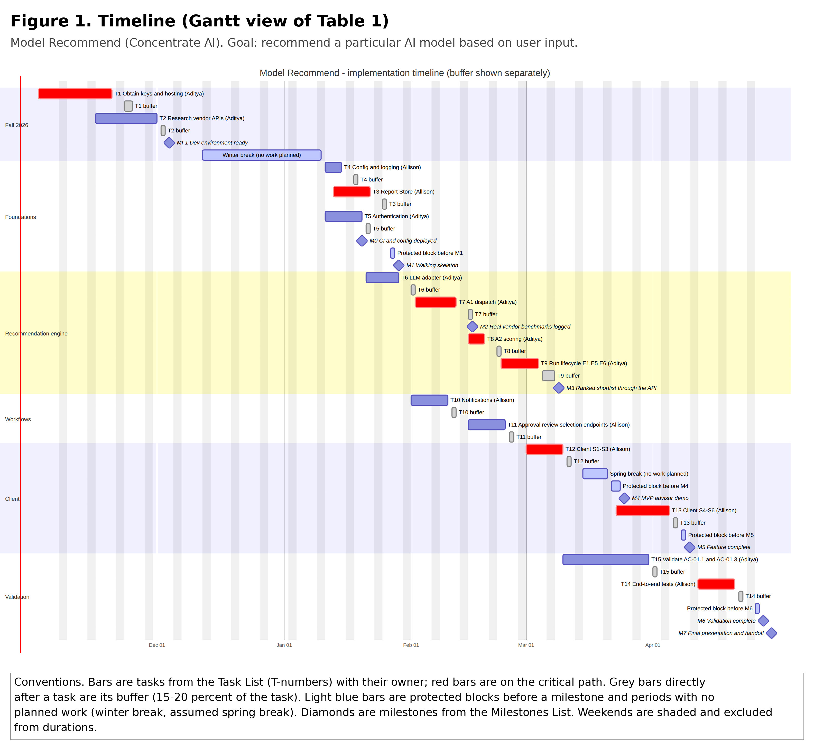
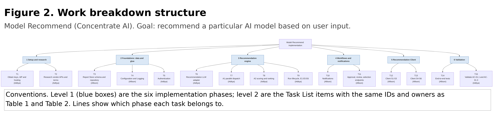

# Task List, Milestones, Timeline, and Effort Matrix

**Project:** Model Recommend (Concentrate AI)
**Team:** Allison Oh, Aditya Pawar
**Advisors:** Jillian Aurisano (Department of Computer Science), Todd Liebermann (Concentrate AI)

This package covers Assignment #5 (Task Lists) and Assignment #6 (Milestones, Timeline, and Effort Matrix). Every task uses the same ID, name and owner in the Task List, Table 1, Table 2, the work breakdown structure and the risk register. Module names come from *Project-Description.md* and *Design_Diagrams* D0–D2.

**Calendar assumptions.** Fall 2026 dates are the CS Senior Design I deadlines in Canvas. Spring 2027 (CS 5002) is assumed to run January 11 – April 30, with spring break March 15–21. We will move the internal milestones to the CS 5002 syllabus dates when it is published. No work is planned over winter break (December 12 – January 10). Both members are in classes, with no co-op, in Spring 2027.

## 1. Task List (Assignment #5)

The same list is committed as `Tasklist.md` in the repository root. Seven tasks are Allison's and eight are Aditya's (about five per member was the guide); each is sized to one or two weeks of work.

| ID | Task | Owner |
|---|---|---|
| T1 | Obtain the vendor API keys, the identity-provider tenant, and the managed PostgreSQL and container hosting from Concentrate AI for the Recommendation Server and Report Store. | Aditya Pawar |
| T2 | Research the rate-limit headers, token-usage fields, prices and benchmarking terms of the OpenAI and Anthropic APIs for the Recommendation LLM adapter (I3). | Aditya Pawar |
| T3 | Develop the Report Store schema, migrations and repository methods (Fig D2-1, I4) in PostgreSQL. | Allison Oh |
| T4 | Develop the Configuration and Logging glue components (getConfig, structured logging, VendorCall usage log). | Allison Oh |
| T5 | Develop the Authentication glue component (JWT verification, AppUser roles, requireRole) for the Recommendation Server. | Aditya Pawar |
| T6 | Develop the Recommendation LLM adapter callVendor for OpenAI and Anthropic, with cost computed from token counts (I3). | Aditya Pawar |
| T7 | Develop A1 parallel benchmark dispatch with per-vendor rate-limit handling and the rate_limit_warning in the Recommendation Server. | Aditya Pawar |
| T8 | Develop A2 weighted scoring, ranking and the reasoning template in the Recommendation Server. | Aditya Pawar |
| T9 | Develop the run lifecycle (Fig D2-3) and endpoints E1, E5 and E6 in the Recommendation Server. | Aditya Pawar |
| T10 | Develop the Notifications glue component (outbox, dispatcher, approval reminder job; Fig D2-5). | Allison Oh |
| T11 | Develop the vendor-approval, review and selection endpoints E2–E4 and E7–E12 in the Recommendation Server. | Allison Oh |
| T12 | Develop the Recommendation Client brief form, run progress and shortlist screens S1–S3 (Fig D2-2). | Allison Oh |
| T13 | Develop the Recommendation Client vendor-approval, review-queue and notification screens S4–S6. | Allison Oh |
| T14 | Test the Recommendation Client and Recommendation Server end to end against AC-01.2, AC-02.1 and AC-02.2 and the edge cases EC-01 to EC-46. | Allison Oh |
| T15 | Validate AC-01.1 (90-second shortlist) and AC-01.3 (rate-limit pause) under real vendor load and refine the A1 defaults. | Aditya Pawar |

## 2. Milestones List (Assignment #6)

Course deliverables come first (dates from Canvas, all due 11:59 PM Eastern); internal milestones follow every one to three weeks through the implementation semester. The only gap longer than three weeks is winter break, when no work is planned (risk R4).

| ID | Milestone | Date | Status | What it demonstrates | How it is verified | Verified by |
|---|---|---|---|---|---|---|
| A1 | Professional Biography | Sep 2, 2026 | **Complete** | Each member's background and goals | Submitted and graded in Canvas | Instructor |
| A2 | Team Formation and Project Description | Sep 9, 2026 | **Complete** | Team, advisors and topic agreed | Submitted and graded; Project-Description.md in repo | Instructor |
| A3 | Advisor Selection and Design Constraints Essay | Sep 18, 2026 | **Complete** | Advisors confirmed; economic, security, social and legal constraints | Submitted and graded; Constraints_Essay.md in repo | Instructor, advisors |
| A4 | User Stories and Use Cases | Sep 28, 2026 | **Complete** | US-01–US-05, UC-01–UC-02 and acceptance criteria | Submitted and graded; User_Stories.md in repo | Instructor |
| A5 | High-Level System Design (D0) | Oct 2, 2026 | **Complete** | Components, interfaces I1–I4, decision log | Submitted and graded; Design_Diagrams/D0 in repo | Instructor |
| A6 | Detailed System Design, Part 1 (D1) | Oct 8, 2026 | **Complete** | Data model, A1, A2, API E1–E4 | Submitted and graded; Design_Diagrams/D1 in repo | Instructor |
| A7 | Detailed System Design, Part 2 (D2) and Peer Review Notes | Oct 14, 2026 | **Complete** (D2 in repo; peer review notes being finalized) | Every component has a data model, behavior and interface; edge cases, traceability, rationale | Design_Diagrams/D2 and Peer_Review_Notes.md in repo; peer review | Instructor, reviewing team |
| A8 | Task List, Milestones, Timeline, and Effort Matrix | Oct 28, 2026 | Complete on submission | This plan: owners, dates, effort and risks | Submitted PDF; Tasklist.md and Planning/ in repo | Instructor, advisors |
| A9 | Requirements Document and Technical Specification | Oct 30, 2026 | Planned | Requirements and specification; D2 traceability becomes the traceability matrix | Submitted and graded | Instructor |
| A10 | Test and Validation Plan Draft | Nov 4, 2026 | Planned | How each acceptance criterion and EC row will be tested (input to T14, T15) | Submitted and graded | Instructor |
| A11 | Ethics and Responsible-Use Statement | Nov 11, 2026 | Planned | Data handling, vendor terms, explainability (constraints essay) | Submitted and graded | Instructor |
| A12 | Presentation Draft and Documented Advisor Feedback | Nov 18, 2026 | Planned | Presentation reviewed by advisors | Feedback recorded in the submission | Advisors, instructor |
| A13 | Team Oral Presentation, Recorded Video, and Peer Reviews | Nov 18, 2026 | Planned | Team can present the design and plan | Presentation delivered; peer reviews | Instructor, peers |
| A14 | Design Report, Design Notebook, and Team and Self Assessment | Dec 2, 2026 | Planned | Complete Fall design record; Week 14 report reproduces Tables 1 and 2 | Submitted and graded | Instructor |
| A15 | Project Advisor Assessments | Dec 8, 2026 | Planned | Advisors' assessment of the team | Advisor forms submitted | Advisors |
| MI-1 | Development environment ready | Dec 4, 2026 | Planned | Keys, IdP tenant and hosting work (T1); vendor research memo with prices, headers and terms (T2) | A test call to each vendor succeeds from the hosted container; memo in repo | Aditya Pawar; Todd Liebermann confirms access |
| M0 | CI and configuration deployed | Jan 20, 2027 | Planned | CI runs tests on every push; config and logging live on the host (T4) | Green CI run; a startup log line in the platform | Allison Oh |
| **M1** | **Walking skeleton** | Jan 29, 2027 | Planned | Authenticated request reaches the Server and reads and writes the Report Store (T3, T4, T5) | Demo: sign in, call a test endpoint, row written and read back | Both members; advisor review |
| M2 | Real vendor benchmarks logged | Feb 16, 2027 | Planned | A1 sends prompts to both vendors with per-vendor limits; every call in VendorCall with cost (T6, T7) | Run log shows calls, tokens and cost for 2 vendors; a forced 429 pauses one vendor | Aditya Pawar; Allison reviews |
| M3 | Ranked shortlist through the API | Mar 9, 2027 | Planned | E1 → run → E5 returns a scored, reasoned shortlist (US-01, US-02) (T8, T9) | Scripted API run on 3 briefs; scores 0–100; result in under 90 s | Both members |
| **M4** | **MVP advisor demo** | Mar 25, 2027 | Planned | A product manager can submit a brief and read the shortlist in the Client (T12) | Live demo to advisors | Jillian Aurisano, Todd Liebermann |
| M5 | Feature complete | Apr 10, 2027 | Planned | Vendor approval, review, selection and notifications work (US-03, US-04, US-05) (T10, T11, T13) | Walk-through of UC-01 alternate flow and UC-02 | Both members; advisor review |
| **M6** | **Validation complete** | Apr 28, 2027 | Planned | All acceptance criteria pass; AC-01.1 met under real load (T14, T15) | Test report with pass/fail per AC and EC | Allison Oh (tests), Aditya Pawar (load); advisors sign off |
| **M7** | **Final presentation and handoff to Concentrate AI** | Apr 30, 2027 (assumed) | Planned | Working system and documentation handed over | Final presentation; repository handed to Concentrate AI | Instructor, advisors |

## 3. Table 1: Timeline (Assignment #6)

Each task's completion date includes its buffer, shown explicitly as working days and as a share of the task (15–20 percent). Major milestones (bold: M1, M4, M6, M7) and M5 have a protected block of 2–3 working days before them that holds no planned work and absorbs slips. **CP** marks the critical path: T1 → T3 → T7 → T8 → T9 → T12 → T13 → T14 → M6 → M7. Risk mitigations that take schedule time are noted in the last column.

| ID | Task (short) | Owner | Start | Work done | Buffer | Completion | Depends on | CP | Risk notes |
|---|---|---|---|---|---|---|---|---|---|
| T1 | Obtain keys, IdP and hosting | Aditya Pawar | Nov 2, 2026 | Nov 20 | 3 d (17%) | Nov 25, 2026 | none | ✔ | R2: request sent Nov 2; fallback by Nov 25 |
| T2 | Research vendor APIs, prices and terms | Aditya Pawar | Nov 16, 2026 | Dec 1 | 2 d (15%) | Dec 3, 2026 | none | | R7: terms review here |
| MI-1 | Development environment ready | | | | | **Dec 4, 2026** | T1, T2 | | |
| — | Winter break, no planned work | | Dec 12, 2026 | | | Jan 10, 2027 | | | R4 |
| T4 | Configuration and Logging | Allison Oh | Jan 11, 2027 | Jan 15 | 1 d (17%) | Jan 18, 2027 | T1 | | |
| T3 | Report Store schema and repository | Allison Oh | Jan 13, 2027 | Jan 22 | 2 d (20%) | Jan 26, 2027 | T1 | ✔ | |
| T5 | Authentication | Aditya Pawar | Jan 11, 2027 | Jan 20 | 2 d (20%) | Jan 22, 2027 | T1 | | |
| M0 | CI and configuration deployed | | | | | **Jan 20, 2027** | T4 | | |
| — | Protected block before M1 | | Jan 27, 2027 | | | Jan 28, 2027 | | | |
| **M1** | **Walking skeleton** | | | | | **Jan 29, 2027** | T3, T4, T5 | ✔ | |
| T6 | Recommendation LLM adapter | Aditya Pawar | Jan 21, 2027 | Jan 29 | 2 d (20%) | Feb 2, 2027 | T2, T4 | | R3: mock vendor in CI |
| T10 | Notifications | Allison Oh | Feb 1, 2027 | Feb 10 | 2 d (20%) | Feb 12, 2027 | T3, T4 | | |
| T7 | A1 parallel dispatch | Aditya Pawar | Feb 2, 2027 | Feb 12 | 2 d (18%) | Feb 16, 2027 | T3, T6 | ✔ | R1 |
| M2 | Real vendor benchmarks logged | | | | | **Feb 16, 2027** | T6, T7 | ✔ | |
| T8 | A2 scoring and ranking | Aditya Pawar | Feb 15, 2027 | Feb 19 | 1 d (17%) | Feb 22, 2027 | T7 | ✔ | |
| T11 | Approval, review and selection endpoints | Allison Oh | Feb 15, 2027 | Feb 24 | 2 d (20%) | Feb 26, 2027 | T3, T5, T10 | | |
| T9 | Run lifecycle, E1, E5, E6 | Aditya Pawar | Feb 23, 2027 | Mar 4 | 2 d (20%) | Mar 8, 2027 | T7, T8 | ✔ | |
| M3 | Ranked shortlist through the API | | | | | **Mar 9, 2027** | T8, T9 | ✔ | R1 check: run under 70 s |
| T12 | Client S1–S3 | Allison Oh | Mar 1, 2027 | Mar 10 | 2 d (20%) | Mar 12, 2027 | T5, T9 (mock API from Feb 22) | ✔ | R6: build against the D2 API contract first |
| T15 | Validate AC-01.1 and AC-01.3 | Aditya Pawar | Mar 10, 2027 | Mar 31 (spring break excluded) | 2 d (15%) | Apr 2, 2027 | T9 | | R1: tune concurrency and deadline |
| — | Spring break (assumed), no planned work | | Mar 15, 2027 | | | Mar 21, 2027 | | | R4 |
| — | Protected block before M4 | | Mar 22, 2027 | | | Mar 24, 2027 | | | |
| **M4** | **MVP advisor demo** | | | | | **Mar 25, 2027** | T12 | ✔ | |
| T13 | Client S4–S6 | Allison Oh | Mar 23, 2027 | Apr 5 | 2 d (17%) | Apr 7, 2027 | T11, T12 | ✔ | |
| — | Protected block before M5 | | Apr 8, 2027 | | | Apr 9, 2027 | | | |
| M5 | Feature complete | | | | | **Apr 10, 2027** | T10, T11, T13 | ✔ | |
| T14 | End-to-end tests | Allison Oh | Apr 12, 2027 | Apr 21 | 2 d (20%) | Apr 23, 2027 | T9, T13, T15 | ✔ | |
| — | Protected block before M6 | | Apr 26, 2027 | | | Apr 27, 2027 | | | |
| **M6** | **Validation complete** | | | | | **Apr 28, 2027** | T14, T15 | ✔ | |
| **M7** | **Final presentation and handoff** | | | | | **Apr 30, 2027** | M6 | ✔ | Date assumed |

## 4. Table 2: Effort Matrix (Assignment #6)

Each estimate is the PERT expected value (O + 4M + P) / 6 from the owner's optimistic, most likely and pessimistic hours. The owner (**bold**, ★) carries the largest share of every task; the other member's hours are code review, pairing on interfaces, and testing.

| ID | Task (short) | O / M / P (h) | Expected (h) | Aditya Pawar (h) | Allison Oh (h) | Row total (h) |
|---|---|---|---|---|---|---|
| T1 | Obtain keys, IdP and hosting | 4 / 8 / 16 | 9 | **8 ★** | 1 | 9 |
| T2 | Research vendor APIs, prices and terms | 4 / 6 / 10 | 6 | **5 ★** | 1 | 6 |
| T3 | Report Store schema and repository | 12 / 18 / 30 | 19 | 4 | **15 ★** | 19 |
| T4 | Configuration and Logging | 6 / 10 / 16 | 10 | 2 | **8 ★** | 10 |
| T5 | Authentication | 8 / 12 / 20 | 13 | **11 ★** | 2 | 13 |
| T6 | Recommendation LLM adapter | 10 / 16 / 26 | 17 | **15 ★** | 2 | 17 |
| T7 | A1 parallel dispatch | 16 / 24 / 40 | 25 | **21 ★** | 4 | 25 |
| T8 | A2 scoring and ranking | 8 / 12 / 20 | 13 | **10 ★** | 3 | 13 |
| T9 | Run lifecycle, E1, E5, E6 | 10 / 16 / 26 | 17 | **13 ★** | 4 | 17 |
| T10 | Notifications | 10 / 14 / 24 | 15 | 3 | **12 ★** | 15 |
| T11 | Approval, review and selection endpoints | 12 / 18 / 28 | 19 | 3 | **16 ★** | 19 |
| T12 | Client S1–S3 | 14 / 20 / 32 | 21 | 4 | **17 ★** | 21 |
| T13 | Client S4–S6 | 14 / 20 / 32 | 21 | 3 | **18 ★** | 21 |
| T14 | End-to-end tests | 10 / 16 / 26 | 17 | 4 | **13 ★** | 17 |
| T15 | Validate AC-01.1 and AC-01.3 | 8 / 14 / 24 | 15 | **12 ★** | 3 | 15 |
| | **Column total (h)** | | **237** | **118 (49.8%)** | **119 (50.2%)** | **237** |
| | Tasks owned | | | 8 | 7 | 15 |

**Balance.** The hour columns are even (118 vs 119), but Aditya owns eight tasks to Allison's seven, and his tasks sit on the critical path in February while Allison's load peaks in March–April. Aditya's hours are front-loaded (95 h before M3, 23 h after), while Allison's are more even but heavier late in the term (68 h before M3, 51 h after).

**Rebalancing plan.** Each member logs hours weekly in the Planning folder. At each milestone we compare logged hours with this matrix; if either member is more than 10 percent over plan, the next unstarted task moves its secondary hours to the lighter member, or the owner changes (first candidates: T11 or T15, which either member can do). After M3, Aditya takes over the Playwright test scaffolding inside T14 (raising his share there) so the April load is shared.

## 5. Work Breakdown Structure

| Phase (level 1) | Tasks (level 2) |
|---|---|
| 1 Setup and research | T1 Obtain keys, IdP and hosting (Aditya); T2 Research vendor APIs, prices and terms (Aditya) |
| 2 Foundations: data and glue | T3 Report Store schema and repository (Allison); T4 Configuration and Logging (Allison); T5 Authentication (Aditya) |
| 3 Recommendation engine | T6 Recommendation LLM adapter (Aditya); T7 A1 parallel dispatch (Aditya); T8 A2 scoring and ranking (Aditya); T9 Run lifecycle, E1, E5, E6 (Aditya) |
| 4 Workflows and notifications | T10 Notifications (Allison); T11 Approval, review and selection endpoints (Allison) |
| 5 Recommendation Client | T12 Client S1–S3 (Allison); T13 Client S4–S6 (Allison) |
| 6 Validation | T14 End-to-end tests (Allison); T15 Validate AC-01.1 and AC-01.3 (Aditya) |

## 6. Risk Register

Likelihood and impact are Low, Medium or High. Each risk names where its mitigation shows up in Table 1.

| ID | Category | Risk | Likelihood | Impact | Strategy | Mitigation (where it shows in Table 1) | Owner | Trigger |
|---|---|---|---|---|---|---|---|---|
| R1 | Technical | Vendor latency and rate limits make the 90-second shortlist (AC-01.1) unreachable | Medium | High | Reduce | T2 measures limits early; M3 checks run time; T15 tunes concurrency and the deadline before M4 and M6 | Aditya Pawar | A run at M2 or M3 takes over 70 s |
| R2 | External | Concentrate AI is slow to provide API keys, the identity-provider tenant or hosting | Medium | High | Reduce | T1 starts Nov 2 with 3 d buffer; fallback to team-paid keys, local Docker PostgreSQL and a free IdP tier so T3–T5 can start Jan 11 | Aditya Pawar | Access not granted by Nov 25 |
| R3 | External | Vendor spend during development grows past what Concentrate AI expects | Medium | Medium | Reduce | Mock vendor in CI (T6); per-client run caps; weekly spend check from the VendorCall log | Aditya Pawar | Spend above USD 50 in a week |
| R4 | Team | Finals, winter break and spring break cut available hours | High | Medium | Accept | No tasks planned Dec 12 – Jan 10 or Mar 15–21; buffer on every task | Allison Oh | Any task slips more than 3 working days |
| R5 | Team | One member is unavailable for a week or more (two-person team) | Low | High | Reduce | Secondary hours on every task (Table 2) so each member knows the other's code; shared docs | Allison Oh | A member is out more than 5 working days |
| R6 | Technical | The Client is blocked waiting for the Server API | Medium | Medium | Reduce | T12 builds against a mock of the D2 API contract from Feb 22; T9 is on the critical path and M3 checks it | Allison Oh | T9 not complete by Mar 8 |
| R7 | External | A vendor's terms restrict benchmarking or showing comparisons | Low | High | Avoid | T2 reviews terms; reports stay private to each client (EC-35); no public comparisons | Aditya Pawar | A restrictive clause is found in T2 |
| R8 | Technical | The identity provider choice (D2 gap G8) delays authentication | Medium | Medium | Reduce | Decided in T1; T5 uses standard OIDC so the provider can change | Aditya Pawar | No provider chosen by Dec 4 (MI-1) |

## 7. Consistency Check

| ID | Task List | WBS phase | Table 1 | Table 2 | Owner in all four |
|---|---|---|---|---|---|
| T1–T2 | ✔ | 1 | ✔ | ✔ | Aditya Pawar |
| T3–T4 | ✔ | 2 | ✔ | ✔ | Allison Oh |
| T5 | ✔ | 2 | ✔ | ✔ | Aditya Pawar |
| T6–T9 | ✔ | 3 | ✔ | ✔ | Aditya Pawar |
| T10–T11 | ✔ | 4 | ✔ | ✔ | Allison Oh |
| T12–T13 | ✔ | 5 | ✔ | ✔ | Allison Oh |
| T14 | ✔ | 6 | ✔ | ✔ | Allison Oh |
| T15 | ✔ | 6 | ✔ | ✔ | Aditya Pawar |
